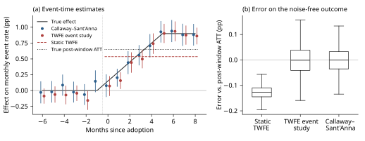

# Static TWFE vs. Callaway–Sant'Anna on a Simulated Staggered Rollout: Bias and Variance under a Ramping Effect

A Monte Carlo study with simulated data. No real policy or market is analysed.

## Abstract

When a policy is adopted at different dates and its effect grows after adoption, the static two-way fixed effects (TWFE) regression compares late adopters with early adopters whose effect is still rising, and is biased. We simulate a staggered rollout (100 units, 24 months, four adoption cohorts and a never-treated group) with a binary monthly outcome, a 3% baseline rate and an effect that ramps linearly to +0.9 percentage points over six months. Over 2,000 replications, the static TWFE coefficient underestimates the true post-adoption effect (0.65 pp, averaged over months 0–8) by 0.13 pp, or 20%. A fully dynamic TWFE event study and the Callaway–Sant'Anna estimator are unbiased in this design. In this sample size, however, the bias is ten times smaller than the sampling standard deviation, so static TWFE has the lowest RMSE (1.47 pp vs. 2.90 pp for Callaway–Sant'Anna), and no estimator can detect the effect in a single run. The study uses one data-generating process in which effects are identical across cohorts.

## 1. Setup

**Data-generating process** (`config/experiment.yaml`, `src/staggered_did/simulate.py`). Unit *i* in month *t* has an event with probability

p<sub>it</sub> = logistic(−3.5 + α<sub>i</sub> + γ<sub>i</sub> t/24 + 0.3 sin(2πt/12)) + τ(t − G<sub>i</sub>),

with α<sub>i</sub> ~ N(0, 0.5²), γ<sub>i</sub> ~ N(0, 0.02²), and adoption month G<sub>i</sub> ∈ {10, 12, 14, 16, never}, 20 units each, assigned at random. The effect is τ(e) = 0.009 · min(e + 1, 6)/6 for e ≥ 0 and 0 before adoption. It is the same in every cohort; only its dynamics create heterogeneity across 2×2 comparisons.

**Estimands.** τ(e) for e ∈ [−6, 8], and the post-window ATT, the equal-weight average of τ(e) over e = 0, …, 8 (0.65 pp). Every cohort is observed for at least nine months after adoption, so this window is balanced across cohorts.

**Estimators** (`src/staggered_did/estimators.py`).

- *Static TWFE*: y<sub>it</sub> = β D<sub>it</sub> + unit FE + month FE, standard errors clustered by unit.
- *TWFE event study*: one dummy per event time in [−6, 8] (e = −1 omitted, endpoints binned), unit and month FE.
- *Callaway–Sant'Anna* (2021): group-time ATTs against never-treated units, varying base period, no covariates; aggregated by event time with cohort-size weights. Standard errors from a unit bootstrap stratified by cohort.

TWFE uses the within transformation, which is exact for a balanced panel; tests check coefficients and clustered standard errors against `statsmodels`, and check that both event-study estimators recover τ(e) exactly when parallel trends hold without noise. The Callaway–Sant'Anna implementation is cross-checked against the R `did` package (Section 4).

**Noise-free runs.** Each estimator is also applied to the expected outcome p<sub>it</sub> instead of the binary outcome. This removes Bernoulli noise, so the remaining error is the estimator's bias plus the chance imbalance of unit trends across cohorts.

## 2. Results

<p align="center"></p>

*Figure 1. (a) Mean event-time estimates over 2,000 replications (bars: ±1.96 Monte Carlo standard errors), the true effect τ(e), the mean static TWFE coefficient and the true post-window ATT. (b) Error of each post-window estimate against the true ATT on the noise-free outcome, one point per replication (boxes: quartiles; whiskers: 1.5 IQR).*

| Estimator | Bias, noise-free (pp) | Bias (pp) | SD (pp) | RMSE (pp) | 95% CI coverage |
|---|---|---|---|---|---|
| Static TWFE | −0.127 | −0.114 | 1.47 | 1.47 | 94.8% |
| TWFE event study | −0.002 | −0.041 | 2.57 | 2.57 | – |
| Callaway–Sant'Anna | −0.002 | −0.026 | 2.90 | 2.90 | 93.6% |

*Table 1. Post-window ATT (true value 0.65 pp), 2,000 replications. Monte Carlo standard errors: at most 0.002 pp for the noise-free bias, 0.03–0.07 pp for the bias on the binary outcome. Coverage is for the true post-window ATT (199 bootstrap draws per replication for Callaway–Sant'Anna).*

**Static TWFE is biased downward.** Its noise-free error averages −0.127 pp, about 20% of the true effect, and is negative in all 2,000 replications (range −0.21 to −0.05 pp; Fig. 1b). Panel (a) shows where it comes from: the event-time effects rise from 0.15 to 0.9 pp, and the single coefficient sits below their average. Against the mean effect over all treated unit-months (0.71 pp), the noise-free shortfall is larger (27%).

**The dynamic estimators are unbiased here.** Their mean estimates agree with τ(e) within Monte Carlo error (Fig. 1a). The TWFE event study is unbiased because the effect is identical across cohorts and a never-treated group exists; with cohort-specific effects its coefficients would mix cohorts (Sun and Abraham, 2021), while Callaway–Sant'Anna would not.

**Variance dominates at this sample size.** The sampling SD of the estimators is 11 to 23 times the static TWFE bias, so static TWFE, which pools all post-adoption months, has the lowest RMSE, and its 95% intervals still cover the true ATT 94.8% of the time. A single replication (`results/single_run.json`) illustrates the problem: the post-window estimates are −0.20 pp (static TWFE, SE 1.61) and −2.36 pp (Callaway–Sant'Anna, SE 2.72) for a true effect of 0.65 pp. The bias of static TWFE scales with the effect size while the SDs shrink with the number of units, so the ranking should reverse in larger samples or with larger effects; this is not simulated here.

## 3. Limitations

- One data-generating process, with effects that differ only by event time. Effects that differ across cohorts would penalise the TWFE event study as well.
- The effect is additive on the probability scale while trends are on the logit scale, so parallel trends hold in expectation over the random assignment of cohorts, not exactly in each sample.
- No covariates, no anticipation and random adoption dates: identification is easy by construction.
- Only one heterogeneity-robust estimator is implemented; Sun–Abraham and imputation estimators are not.

## 4. Cross-check against R `did`

On the single simulated panel, `att_gt` and `aggte(type = "dynamic")` from `did` 2.1.2 (never-treated controls, varying base period) give the same ATT(e) as `cs_event_study` at all 15 event times (maximum absolute difference 1.4 × 10⁻¹⁷; `results/did_crosscheck.csv`). Analytic standard errors from `did` and the unit-bootstrap standard errors here differ by at most 0.003 (outcome scale), as expected for two different variance estimators.

## Reproducibility

```sh
uv venv -p 3.12 && uv pip install -r requirements.txt
make all          # single run, Monte Carlo (about 20 s), figure
make test
make crosscheck   # R `did` comparison in Docker (rocker/r-ver:4.4.1)
```

| Path | Content |
|---|---|
| `config/experiment.yaml` | Data-generating process and study settings |
| `src/staggered_did/simulate.py` | Panel simulator and true effects |
| `src/staggered_did/estimators.py` | Static TWFE, TWFE event study, Callaway–Sant'Anna |
| `src/staggered_did/run.py` | Single run and Monte Carlo; writes `results/` |
| `src/staggered_did/figures.py` | Figure 1 |
| `checks/did_crosscheck.R` | Comparison with the R `did` package |

## References

- Callaway, B. and Sant'Anna, P. H. C. (2021). Difference-in-differences with multiple time periods. *Journal of Econometrics*, 225(2), 200–230.
- Goodman-Bacon, A. (2021). Difference-in-differences with variation in treatment timing. *Journal of Econometrics*, 225(2), 254–277.
- Sun, L. and Abraham, S. (2021). Estimating dynamic treatment effects in event studies with heterogeneous treatment effects. *Journal of Econometrics*, 225(2), 175–199.

Code released under the MIT license.
