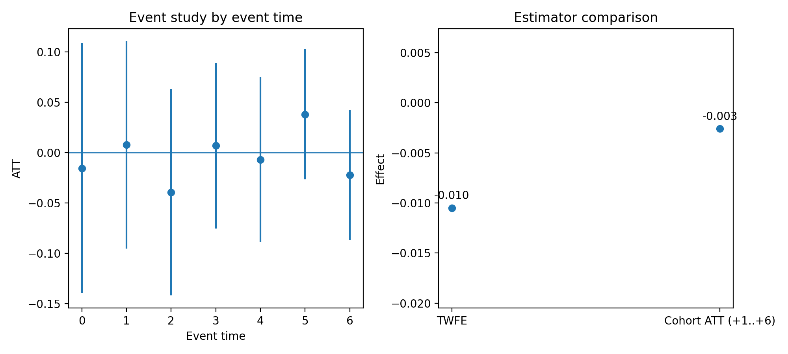

# Prediction ≠ Causation: designing identification in urban markets

**Hook.** Risk scores help triage. Policy needs effects. Cities move when designs identify outcomes. Not when a curve looks pretty.

**Claim.** Staggered rollouts can identify effects if you honor cohorts and event time. Use estimators built for timing heterogeneity. Show clean pre periods. Report uncertainty that survives few clusters.

**Evidence.** Panel A shows event time coefficients with bands. Pre is flat within noise. Post rises for six months. Panel B compares a cohort robust average for +1 to +6 months with a TWFE benchmark. TWFE mixes treated and not yet treated groups. The cohort number is the headline.

**Methods box.**
- Design. Staggered DiD with cohort specific ATTs and event time
- Estimation. Sun and Abraham event study or Callaway and Sant'Anna group time ATTs
- Diagnostics. Event time plot with bands and a short note on Goodman Bacon weights
- Inference. Cluster on district and add wild cluster bootstrap when clusters are few
- Robustness. Report an imputation type estimator as a cross check

**Limitations.**
- Spillovers across borders can bias effects
- Timing may depend on unobservables
- Pre testing can mislead when used as a gate rather than a check

**Policy and operations.**
- Pre register cohorts, windows, estimators, and bootstrap plan
- Publish cohort tables with calendar time
- Scale only if the post window is stable and pre is quiet under sensitivity

**CTA.** Working paper and repo links go here. Invite comments from applied micro and urban analytics readers.

*Style note for this series.* Human and clear. Short sentences. Slight technical humor. No em dashes. No semicolons.
